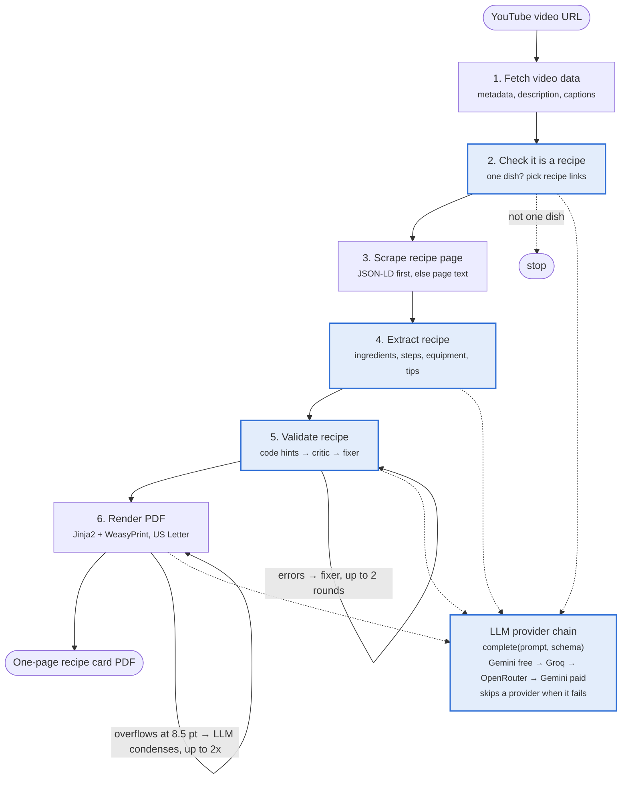

# YouTube → Recipe Card: Pipeline Design

## Overview

The pipeline turns a YouTube cooking video URL into a one-page, US Letter recipe card PDF for a printed recipe book. Six Python steps run in order (`generate_recipe.py`); each step reads and extends one shared state file. Code handles fetching, checking and layout; an LLM handles judgement and writing.

## Workflow

Shaded steps call the LLM; the rest is plain code (step 6 calls it only to condense). Step 2 can stop the run, step 5 loops through the fixer, and step 6 loops until the card fits one page. Every step reads and extends `output/<title>/pipeline.json`.

## Steps and decisions

| Step | What it does | Decision and why |
| --- | --- | --- |
| 1. Fetch video data | yt-dlp pulls title, description and chapters; youtube-transcript-api pulls captions. | No video download and no API key. Captions are the main source of what the cook says. |
| 2. Check it's a recipe (LLM) | Gate: is this one dish? Picks recipe links from the description. | Rejects non-recipes and compilations early, before costly steps. Uses only the first 500 transcript words. Links are filtered to URLs really in the description, so invented links are dropped. |
| 3. Scrape recipe page | requests + BeautifulSoup on each link; schema.org Recipe JSON-LD first, page text as fallback. | No LLM. Written recipes are the most reliable amounts. Sites with bot checks are skipped, not worked around. |
| 4. Extract recipe (LLM) | Builds a structured recipe: ingredient groups, step groups, equipment, tips. | Page trusted for amounts, transcript for technique and cues. Keeps the video's units, no conversion. Never fills gaps from general cooking knowledge; a missing amount stays "to taste". |
| 5. Validate recipe (LLM) | Code checks, then LLM critic, then LLM fixer; up to 2 fix rounds. | Evaluator-optimizer loop. Code catches cheap, certain problems (unused ingredients, step amounts not in the list) and passes them as hints; the critic decides against the sources. A recipe still not approved is rendered anyway. |
| 6. Render PDF | Jinja2 HTML template to WeasyPrint PDF, US Letter. | Same layout for every card. Fit loop: font 12 pt down to 8.5 pt; if it still overflows, the LLM condenses the text, up to 2 times. |

## Design decisions across steps

- **One state file per video.** Every step reads and extends `output/<title>/pipeline.json`. Any step can be rerun on its own from the URL, and the full run is inspectable after the fact.
- **Pydantic models for all data.** Each step's output is a typed model. LLM replies are validated against the same models; an invalid reply is sent back with the error, up to 2 retries.
- **No agent framework.** The workflow is fixed, so plain Python functions call the LLM only where judgement is needed (steps 2, 4, 5, and the condense fallback in 6).
- **Model-agnostic LLM layer.** Steps call one function, `complete(prompt, schema)`. Behind it, one class per provider (Gemini, Groq, OpenRouter, paid Gemini, local Ollama) shares a single `chat()` interface. A chain tries them in the order set in `.env`; a provider that is out of credits or has a bad key is skipped for the rest of the run, and a rate-limited one for 60 seconds. This keeps free tiers usable and puts the paid key last.
- **Temperature 0.** Extraction should give the same card on every run.
- **Consistent units and format.** No unit normalisation: the card keeps the cook's units so it matches the video.
