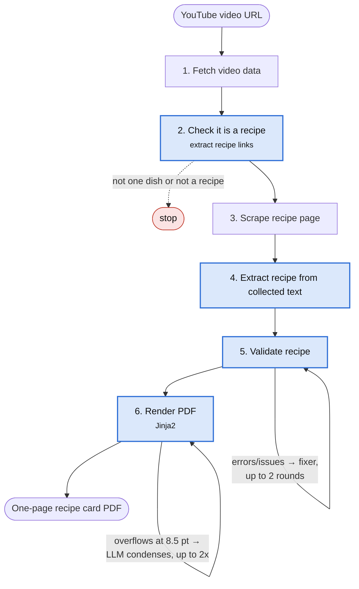

# YouTube → Recipe Card: Pipeline Design

## Overview

The pipeline turns a YouTube cooking video URL into a one-page, US Letter recipe card PDF for a printed recipe book. Six Python steps run in order (`generate_recipe.py`); each step reads and extends one shared state file. Code handles fetching, checking and layout; an LLM handles judgement and writing.

## Workflow

Shaded steps call the LLM through a chain of providers because I am cheap and don't want to pay for my LLM usage. 
Models go down all the time as well so this can help the system be a bit more robust. Future work will run a local LLM when
it won't fry my computer.

## Steps and decisions

| Step | What it does | 
| --- | --- | 
| 1. Fetch video data | yt-dlp pulls title, description and chapters; youtube-transcript-api pulls captions. |  
| 2. Check it's a recipe (LLM) | Gate: is this one dish? Picks recipe links from the description as well. | 
| 3. Scrape recipe page | requests + BeautifulSoup on each link to parse out the page  | 
| 4. Extract recipe (LLM) | Builds a structured recipe: ingredient groups, step groups, equipment, tips from the video data + recipe page if it exists. | 
| 5. Validate recipe (LLM) | Code checks by comparing ingredients, then llm validator finalizes the critics and sends back for another round of work. Up to 2 fix rounds. |
| 6. Render PDF | Jinja2 HTML template to WeasyPrint PDF, US Letter. LLM is used to check if its longer than 1 page and will attempt to shrink up to two times.| 
